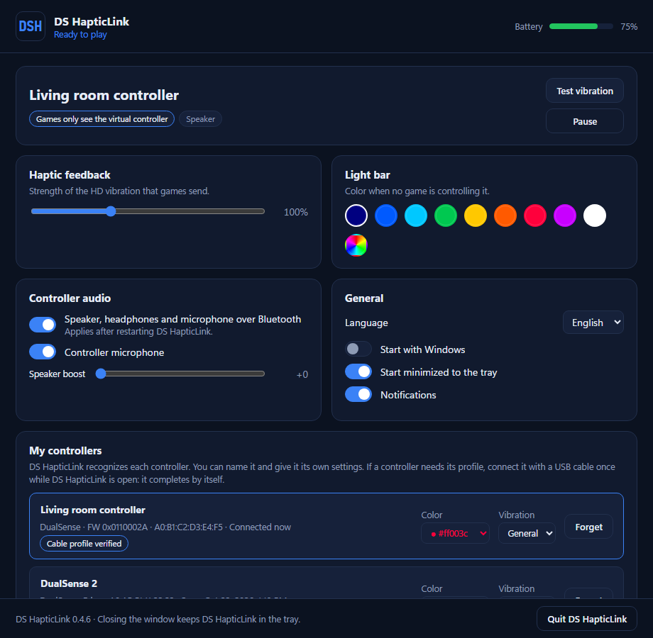
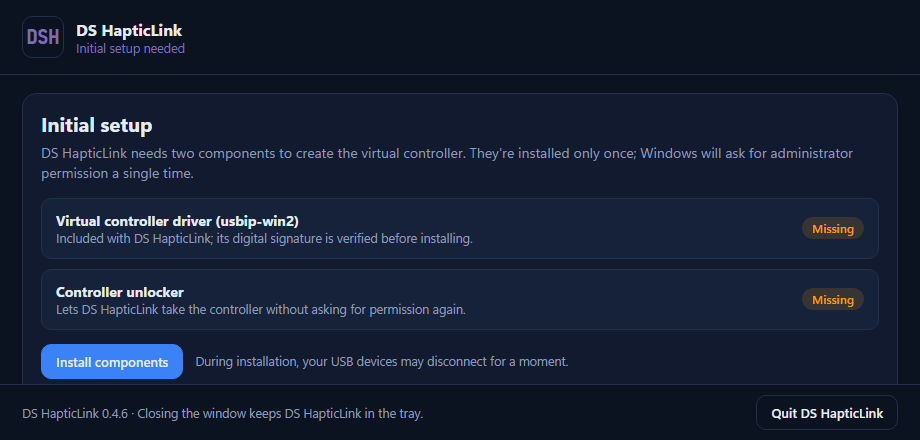

<p align="center"></p>

<h1 align="center">DS HapticLink</h1>

<p align="center"><b>Native DualSense HD haptics, adaptive triggers, speaker, headphone jack and microphone over
Bluetooth on Windows.</b><br>Free and open source. No Xbox emulation, no HidHide.</p>

<p align="center"></p>

---

## What it does

PC games with native DualSense support (God of War Ragnarök, Stellar Blade, Spider-Man 2, Cyberpunk 2077…) only
turn on HD haptics, adaptive triggers and the controller's speaker when the controller is plugged in **by USB
cable**. Over Bluetooth you just get basic rumble.

DS HapticLink fixes that. It creates a **virtual wired DualSense** on your PC and links it to your real
controller over Bluetooth. Games see a USB DualSense and enable everything; DS HapticLink carries it all to
your controller wirelessly.

| Over Bluetooth | |
|---|---|
| HD haptic feedback | ✅ |
| Adaptive triggers | ✅ |
| Light bar and player LEDs | ✅ |
| Controller speaker and headphone jack (game audio) | ✅ |
| Microphone (with the mute button and its LED) | ✅ |
| Motion sensors, touchpad, battery level | ✅ |

**Other features:**
- **Simple setup:** one administrator prompt, once. After that it never asks again.
- **Tray app** with a colored "DSH" icon that shows the status at a glance.
- **My controllers:** remembers each DualSense with its own name, light bar color and vibration strength.
- **Optional cable profile:** connect a controller by USB once and DS HapticLink saves its exact profile, for
  the best compatibility with any DualSense model.
- **English and Spanish** interface.
- **Portable:** unzip and run. Settings stay next to the app.

## Requirements

- Windows 10 or 11 (64-bit).
- A Bluetooth adapter, with your DualSense already paired in Windows Bluetooth settings.
- The Microsoft Edge WebView2 runtime for the window (included in Windows 11; on Windows 10 DS HapticLink
  offers to install it, or runs from the tray without it).

## Install

1. Download `DSHapticLink-<version>-portable.zip` from [Releases](../../releases) and unzip it anywhere
   (for example `C:\Program Files\DSHapticLink` or your Documents folder).
2. Open `DSHapticLink.exe`.
3. Click **Install components** and accept the Windows administrator prompt. This installs:
   - **usbip-win2**, the open-source driver that creates the virtual controller (included in the zip; its digital
     signature is verified before installing).
   - A small **helper** in `C:\Program Files\DSHapticLink Helper` and a scheduled task, so DS HapticLink can take
     the controller without asking for permission every time.
4. Turn on your DualSense (PS button). The icon turns blue: you're ready to play.

<p align="center"></p>

> **Windows SmartScreen** may show "Windows protected your PC" the first time, because the app isn't
> code-signed (certificates cost money and this is a free project). Click **More info → Run anyway**. Some
> antivirus programs may also flag it by mistake; you can check the source code and build it yourself.

## Using it

- Open DS HapticLink **before** the game. Closing the window keeps it running in the tray.
- In Steam, **turn off Steam Input** for the game (game Properties → Controller → *Disable Steam Input*), so the
  game sees the DualSense directly.
- Tray icon colors: **blue** ready · **green** a game is using the controller · **amber** waiting for the
  controller · **gray** paused · **red** setup needed or a problem.

## Compatible games

Around **190 PC games** use DualSense haptics and/or adaptive triggers natively. See the full list in
[docs/GAMES.md](docs/GAMES.md) (based on [PCGamingWiki](https://www.pcgamingwiki.com/wiki/Controller:DualSense)).

Tested with DS HapticLink: **God of War Ragnarök**, **Stellar Blade** and **Zenless Zone Zero**. Tell us about
others in [Issues](../../issues)!

## Tips and known issues

> **Steam:** Steam keeps the controller open even with PlayStation support disabled, which slows down how fast
> DS HapticLink can take it. For the quickest connection, close Steam before turning on your controller. If Steam
> is open it still connects, it just takes a bit longer (Steam may show "controller connected/disconnected" a few
> times). Once connected, you can open Steam again.

> **Other programs:** the same can happen with other launchers or software that open the controller and don't
> let go of it (other game launchers, controller tools like DS4Windows, DSX or reWASD, overlays, recording
> software). If your controller doesn't connect or takes too long, close anything that might be using it and
> try again.

- **Zenless Zone Zero (and Genshin Impact):** set the DualSense audio device to *Quadraphonic* with all
  full-range speakers enabled (Sound control panel → DualSense Wireless Controller → Configure) before opening
  the game, and keep the game's controller speaker volume at maximum, or the haptics feel wrong.
- **One controller at a time.**
- **After quitting DS HapticLink**, Game Bar and apps using GameInput may not see the controller until you turn it
  off and on again. Games that open the controller themselves see it right away.
- **DualSense Edge:** should work (connect it by cable once so DS HapticLink saves its profile), but it hasn't
  been tested yet.

If something doesn't work, click **Copy diagnostics** in the app and paste it in a new
[issue](../../issues).

## Uninstall

1. In DS HapticLink, go to **General → Uninstall…** (or run `DSHapticLink.exe --uninstall`).
2. Choose whether to also remove the usbip-win2 driver (on by default), click **Uninstall** and accept the
   administrator prompt. It removes the helper in Program Files, the scheduled task, start with Windows and, if
   chosen, usbip-win2.
3. Restart Windows to finish removing the driver, then delete the app folder (and `C:\ProgramData\DSHapticLink`,
   which only holds logs).

Without the window (for example on a PC without WebView2), the same is available from a terminal in the app
folder: `helper\dsh-helper.exe uninstall --drivers` (it asks for administrator permission and shows the result).

## How it works

```
Game ──USB HID + USB audio──▶ virtual DualSense (usbip-win2, USB/IP on 127.0.0.1)
                                   │
                              DS HapticLink  ── translates reports, haptics (48 kHz → 3 kHz) and
                                   │             audio (Opus) to the DualSense Bluetooth protocol
                                   ▼
                         real DualSense over Bluetooth (taken exclusively)
```

Instead of hiding the real controller with a filter driver like HidHide, DS HapticLink briefly restarts it and
opens it **exclusively** in the first millisecond, so games only see the virtual one. More details in
[docs/DEVELOPMENT.md](docs/DEVELOPMENT.md).

## Building from source

See [docs/DEVELOPMENT.md](docs/DEVELOPMENT.md).

## Credits

Built on the protocol work of [DS5Dongle](https://github.com/awalol/DS5Dongle) and
[SAxense](https://github.com/egormanga/SAxense), and on [usbip-win2](https://github.com/vadimgrn/usbip-win2) for
the virtual USB device. Full list of components and licenses in [THIRD_PARTY_NOTICES.md](THIRD_PARTY_NOTICES.md).

## License

[MIT](LICENSE). DualSense and PlayStation are trademarks of Sony Interactive Entertainment Inc. DS HapticLink is an
independent project, not affiliated with Sony or with Paliverse (DSX).
